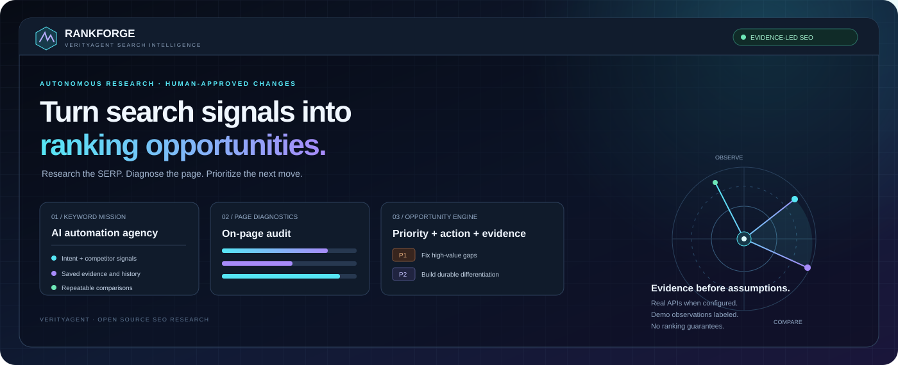

  
  <h1>Verity RankForge</h1>
  
<strong>Evidence-led SEO research, on-page diagnostics, and ranking-opportunity intelligence.</strong>

  

    
    
    
    
    
  

  
<em>Research the SERP. Diagnose the page. Prioritize the next move.</em>

---

## What it does

RankForge investigates a keyword, collects search results through a configured provider, audits an optional target page, and turns the available evidence into a prioritized SEO action queue. Every completed run is saved in SQLite so users can revisit observations and compare changes.

- **Keyword intelligence:** modifier-based intent hypothesis, result sample, observed positions, unique-domain distribution, and target-domain presence checks.
- **Real search integrations:** Brave Search API and DataForSEO Google organic SERP API, with source-aware multi-provider collection when both credentials are configured. Native provider positions are preserved and cross-source URL overlap is measured without blending ranking positions.
- **Honest local mode:** deterministic synthetic results when no provider key is configured; sample results are explicitly marked **DEMO** and use example domains.
- **Single-page SEO audit:** title, meta description, headings, image alt attributes, canonical link, robots noindex, word count, HTTP response and internal-link candidates.
- **SEO content blueprint:** title, description and H1 candidates, a content outline, and observed result-title signals; drafts require editorial validation.
- **Prioritized opportunities:** priority, rationale, next action, estimated effort, evidence and limitations.
- **Historical comparisons:** detect added, removed and moved URLs and domain changes across saved runs, keyed by source so the same URL in two providers remains distinct.
- **Futuristic command center:** responsive dark interface, motion-aware visuals, source-aware result explorer, audit telemetry, evidence-led strategy roadmap, opportunity lab, content blueprint, history comparison and CSV export.
- **Ranking strategy engine:** transparent prioritized actions, a 30-day improvement cycle, sampled competitor-domain coverage, title-term signals, and research ideas explicitly marked as having no validated search-volume data.
- **Optional AI evidence analyst:** when explicitly enabled with an OpenAI API key, generate structured observations, actions and content direction from bounded result metadata. Model-suggested evidence URLs are restricted to URLs present in the run; AI is off by default and does not publish changes.
- **Bounded site crawl:** same-host sitemap discovery, conservative robots exclusions, a capped multi-page audit, and duplicate title/description signals.
- **Durable monitoring:** database-backed recurring missions, job leases, manual run-now, failure history and bounded retry backoff. Run python -m rankforge.worker separately to execute schedules.
- **Monitoring hub:** /monitoring provides a dedicated mission builder for creating, pausing, resuming and executing scheduled keyword monitors.
- **Developer interfaces:** FastAPI endpoints, OpenAPI docs, CLI, Dockerfile, and CI regression tests.

> **No false promises:** RankForge does not guarantee the #1 position, silently replace failed live API calls with fake data, or automatically publish website changes. SEO performance depends on the site, users, competitors, search systems and many factors outside this application.

## Interface

The committed cover art is a product visual, not a screenshot of a deployed site. The working dashboard is served by the application at the root URL.

## Quick start

**Requirements:** Python 3.11 or newer.

~~~bash
git clone https://github.com/muhammadsaeed-ai/verity-rankforge.git
cd verity-rankforge
python -m venv .venv

# macOS / Linux
source .venv/bin/activate
# Windows PowerShell
# .venv\Scripts\Activate.ps1

python -m pip install -e ".[dev]"
cp .env.example .env
# Windows: copy .env.example .env

uvicorn rankforge.main:app --reload
~~~

Open http://127.0.0.1:8000. The monitoring console is at http://127.0.0.1:8000/monitoring, API documentation is at http://127.0.0.1:8000/docs, and service status is at http://127.0.0.1:8000/api/health. Start a second terminal with python -m rankforge.worker to execute saved schedules.

Without credentials the application uses deterministic sample results. These are **not actual rankings**. Set a provider before using data for business decisions.

## Enable a live search provider

Credentials remain in environment variables; never commit your local .env file.

**Brave Search API**

~~~dotenv
RANKFORGE_PROVIDER=brave
BRAVE_API_KEY=replace-with-your-key
~~~

**DataForSEO Google organic SERP**

~~~dotenv
RANKFORGE_PROVIDER=dataforseo
DATAFORSEO_LOGIN=replace-with-your-login
DATAFORSEO_PASSWORD=replace-with-your-password
~~~

**Automatic selection**

Set RANKFORGE_PROVIDER=auto. The application selects multi-source mode when both DataForSEO and Brave credentials are supplied, otherwise the single configured live provider, otherwise the clearly disclosed demo provider. Set RANKFORGE_PROVIDER=multi to require both live sources explicitly. If one source fails, the run retains available results and records a provider warning; if all sources fail, the run fails without substituting demo results. Provider pricing, quotas, supported locations and language options, and terms apply. The current adapters explicitly support United States, United Kingdom, Pakistan, Canada, Australia and India; unsupported locations fail rather than silently returning US-targeted results.

Other runtime settings are documented in .env.example. API keys must only be supplied by the server operator.

## Run a mission

From the dashboard, enter the keyword, optionally add a target website, and choose the market, language and result depth. The application:

1. validates the request and, if supplied, validates the target host before making a potentially billable search call;
2. fetches provider results and removes duplicate or invalid URLs;
3. calculates transparent sample metrics and a keyword-modifier intent hypothesis;
4. audits the supplied page when possible, recording a page-audit error separately if the SERP run succeeded but the page could not be audited;
5. generates an editorial content blueprint and evidence-labeled opportunity queue; and
6. persists the run to SQLite for later inspection and comparison.

The dashboard history supports selecting two runs for a URL-level comparison. Comparisons are strongest when keyword, provider, market, language, result depth and collection conditions match.

## REST API

~~~bash
# Service health and active provider mode
curl http://127.0.0.1:8000/api/health

# Analyze a keyword (demo mode if no provider is configured)
curl -X POST http://127.0.0.1:8000/api/analyze \
  -H "Content-Type: application/json" \
  -d '{"keyword":"AI automation agency","website":"https://example.com","market":"United States","language":"en","depth":10}'

# Audit one page
curl -X POST http://127.0.0.1:8000/api/audit \
  -H "Content-Type: application/json" \
  -d '{"website":"https://example.com"}'

# Recent saved runs
curl "http://127.0.0.1:8000/api/history?limit=20"

# Full detail for run 1
curl http://127.0.0.1:8000/api/runs/1

# Compare runs 1 and 2
curl -X POST http://127.0.0.1:8000/api/compare \
  -H "Content-Type: application/json" \
  -d '{"first_run_id":1,"second_run_id":2}'

# Download a CSV summary
curl -o rankforge-history.csv "http://127.0.0.1:8000/api/export.csv?limit=100"
~~~

### Endpoint map

| Method | Route | Purpose |
|---|---|---|
| GET | /api/health | Runtime readiness, active provider and demo disclosure |
| GET | /api/overview | Workspace counts and recent missions |
| POST | /api/analyze | Collect, analyze and persist a keyword mission |
| POST | /api/audit | Inspect a supplied page's HTML SEO signals |
| GET | /api/history | List saved runs; optional keyword filter |
| GET | /api/runs/{run_id} | Retrieve a saved run |
| POST | /api/compare | Compare two runs with source-aware result identity |
| POST | /api/crawl | Bounded sitemap-led multi-page audit |
| GET | /api/missions | List durable recurring monitors |
| POST | /api/missions | Create a recurring monitor (60-minute minimum interval) |
| PATCH | /api/missions/{mission_id} | Pause or resume a monitor |
| POST | /api/missions/{mission_id}/run | Execute a monitor immediately |
| GET | /api/runs/{run_id}/strategy | Retrieve the saved strategy report |
| GET | /monitoring | Mission builder and schedule console |
| GET | /api/intent?keyword=... | Return the initial intent hypothesis |
| GET | /api/export.csv | Export a bounded run-history summary |

## Architecture

~~~mermaid
flowchart TD
  UI["Futuristic command center"] --> API["FastAPI / CLI"]
  API --> SELECT["Provider registry"]
  SELECT --> BRAVE["Brave Search API"]
  SELECT --> DFS["DataForSEO Google SERP"]
  SELECT --> DEMO["Clearly labeled demo data"]
  BRAVE --> NORM["Source-aware normalization"]
  DFS --> NORM
  DEMO --> NORM
  NORM --> DB[("SQLite runs + monitoring missions")]
  API --> CRAWL["Bounded sitemap-led crawler"]
  API --> STRATEGY["Deterministic strategy engine"]
  DB --> DIFF["Source-aware temporal diff"]
  DIFF --> STRATEGY
  STRATEGY --> AI["Optional OpenAI evidence analyst"]
  AI --> UI
  DB --> WORKER["Separate recurring monitor worker"]
  WORKER --> SELECT
  CRAWL --> STRATEGY
~~~

| Module | Responsibility |
|---|---|
| rankforge/providers.py | Brave, DataForSEO, demo, and source-aware multi-provider adapter |
| rankforge/core.py | Page audit, normalization, source-aware metrics, SQLite run history, comparisons and opportunities |
| rankforge/strategy.py | Deterministic, evidence-grounded action plan and 30-day improvement cycle |
| rankforge/analyst.py | Optional OpenAI analysis with bounded inputs and evidence URL validation |
| rankforge/crawler.py | Bounded same-host sitemap discovery and multi-page SEO checks |
| rankforge/monitoring.py | Durable monitoring missions, job leases, scheduling and retry backoff |
| rankforge/worker.py | Separate background worker for recurring missions |
| rankforge/main.py | REST API, strategy/crawl/monitor endpoints, CSV export and UI serving |
| web/index.html | Responsive futuristic command center with source-aware evidence and strategy report |
| web/monitoring.html | Mission builder, schedule monitor and bounded site-crawl console |
| tests/test_core.py, tests/test_api.py, tests/test_advanced.py, tests/test_analyst.py | Deterministic, API, workflow, crawler and optional-AI regression tests |

## CLI usage

~~~bash
rankforge "AI automation agency" --website https://example.com --market "United States" --language en --depth 10
~~~

The CLI prints the saved analysis as JSON. Use it only for domains you are authorized to assess.

## Tests and quality gate

~~~bash
python -m compileall -q rankforge tests
python -m pytest
~~~

GitHub Actions runs compilation and regression tests on pushes and pull requests. The test suite covers deterministic provider behavior, explicit intent labeling, metrics, content-brief guardrails, HTML parsing, SQLite round trips and added/removed/moved URL comparisons. Tests do not require a live API key or search-provider call.

## Docker

**Recommended: run the API and recurring monitoring worker together with Docker Compose.** First copy `.env.example` to `.env` and add any provider credentials.

~~~bash
docker compose up --build -d
docker compose ps
docker compose logs -f api worker
~~~

The dashboard is available at http://localhost:8000. Change the host-side port mapping in `docker-compose.yml` if port 8000 is already occupied. Stop the services with `docker compose down`; the named `rankforge-data` volume preserves SQLite history and monitoring missions.

To run only the API container manually:

~~~bash
docker build -t verity-rankforge .
docker run --rm -p 8000:8000 \
  -e RANKFORGE_DB_PATH=/app/data/rankforge.sqlite3 \
  -v rankforge-data:/app/data \
  verity-rankforge
~~~

The manual container command does not run the scheduler; start a second worker process against the same database volume. The container runs as a non-root user and the API image provides a health check. Keep `.env` out of source control.

## Scope and limitations

This release is a working research and diagnostics foundation, not a complete autonomous SEO platform.

- Intent classification uses transparent keyword modifiers; it is not a trained semantic classifier.
- The auditor inspects one HTML response per URL in a bounded sitemap-led sample. JavaScript rendering, Core Web Vitals and Search Console OAuth are not implemented; sitemap and robots handling is conservative rather than standards-complete.
- Search observations are synchronous snapshots, while recurring monitors execute through a separate durable worker process. Adaptive sampling, alert delivery, CMS integrations and fully autonomous website changes are not implemented.
- Site discovery is a bounded sitemap-led sample capped at 30 pages. Robots handling is deliberately conservative, and JavaScript-rendered content may be missed.
- Multi-source collection compares result sets; it intentionally does not report a blended mean rank across different providers.
- Content briefs start with deterministic drafts; optional OpenAI evidence analysis can be enabled via environment credentials. Deep page-content extraction, Search Console integration and CMS change workflows remain future work.
- The application does not automatically edit or deploy a website, and it cannot promise rankings. The heuristic audit score is not a Google score.
- Authentication and tenant isolation are not included. Put an authentication layer and network controls in front of any internet-facing deployment; do not run the development console as a public multi-user service.

## Responsible use and security

- Follow provider terms, usage limits and billing.
- Do not rotate browsers or automate prohibited queries to evade limits or manufacture search traffic.
- The page auditor only accepts HTTP(S), rejects local/private/reserved IP targets, revalidates redirects and caps redirect depth and HTML size. Audit only websites you are authorized to inspect.
- Keep secrets in environment variables or a secret manager. See SECURITY.md before deployment.

## Contributing

Issues and pull requests are welcome. Include a reproduction case and a regression test for behavior changes. Never include credentials, customer data or private target URLs in fixtures.

## Maintained by VerityAgent

Built as an open-source product initiative by **VerityAgent**.

## Advanced monitoring and site intelligence

Start the API and the worker in two terminals. The worker polls the SQLite-backed mission table, claims due jobs with a lease to reduce duplicate execution, and records successful run IDs or errors. The minimum recurring interval is 60 minutes; transient failures use a bounded retry backoff.

~~~bash
# Terminal 1: API and dashboard
uvicorn rankforge.main:app --reload

# Terminal 2: recurring mission worker
python -m rankforge.worker
~~~

The dashboard at /monitoring creates and manages recurring keyword missions. Use the API for bounded site discovery and deeper integrations:

~~~bash
# Audit up to 20 discovered pages
curl -X POST http://127.0.0.1:8000/api/crawl \
  -H "Content-Type: application/json" \
  -d '{"website":"https://example.com","max_pages":20}'

# Create a daily keyword observation (first run is due immediately)
curl -X POST http://127.0.0.1:8000/api/missions \
  -H "Content-Type: application/json" \
  -d '{"keyword":"AI automation agency","website":"https://example.com","market":"United States","language":"en","depth":10,"interval_minutes":1440}'

# List missions, pause/resume, or execute a mission immediately
curl http://127.0.0.1:8000/api/missions
curl -X PATCH http://127.0.0.1:8000/api/missions/1 -H "Content-Type: application/json" -d '{"enabled":false}'
curl -X POST http://127.0.0.1:8000/api/missions/1/run
~~~

The site crawl respects a conservative subset of robots directives, restricts discovered pages to the supplied hostname, and caps the audit at 30 pages. This protects against unbounded crawls but is not a replacement for a standards-complete crawler.

Optional OpenAI analysis is disabled by default. Add OPENAI_API_KEY and set RANKFORGE_AI_ANALYSIS=true in the server environment to enable it; OPENAI_MODEL selects the model. Results without AI configuration remain fully usable with deterministic strategy synthesis. AI suggestions are stored as proposals, are bounded to the evidence supplied, and never auto-publish to a website.

The strategy report is saved in each run's content blueprint under content_brief.strategy. It includes sampled visibility, observed title-term signals, query ideas with no implied search volume, evidence-linked actions, and a 30-day improvement cycle. These are research aids; they do not guarantee rankings.

## License

MIT — see LICENSE.
